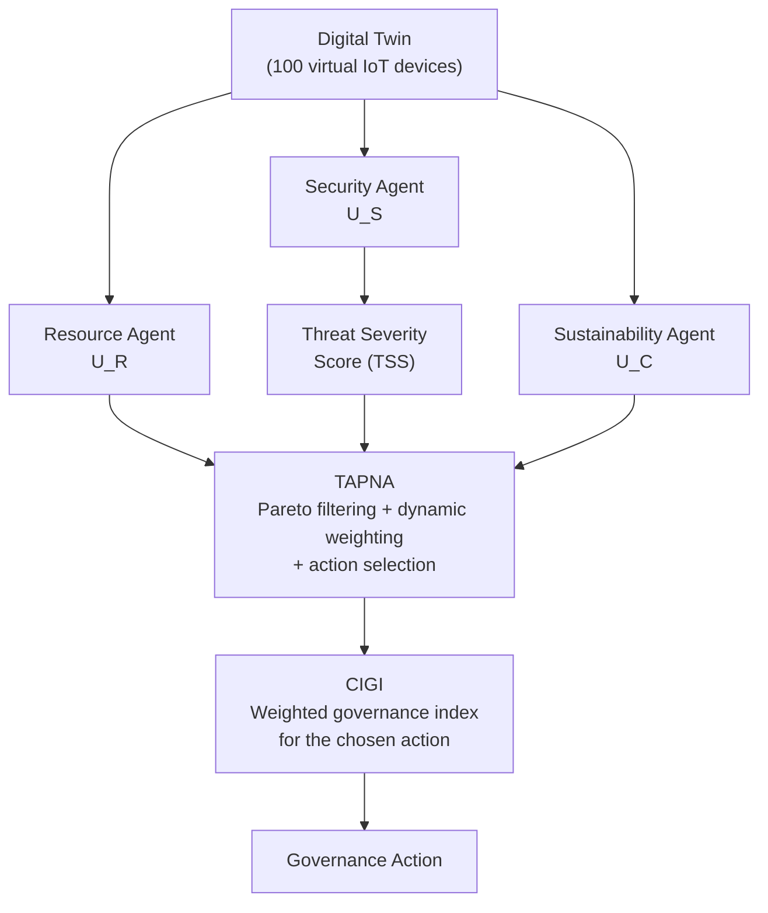
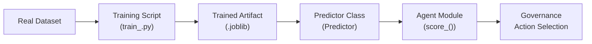

# Multi-Agent Cloud-IoT Governance

**Digital-Twin-Driven Adaptive Governance with Specialized AI Agents, Threat-Adaptive Pareto Negotiation, and Constraint-Aware Global Index**

---

## Table of Contents

- [Project Overview](#project-overview)
- [Key Objectives](#key-objectives)
- [System Architecture](#system-architecture)
- [How the System Works](#how-the-system-works)
- [Digital Twin](#digital-twin)
- [AI Agent Layer](#ai-agent-layer)
- [Machine Learning Pipeline](#machine-learning-pipeline)
- [Resource Intelligence](#resource-intelligence)
- [Security Intelligence](#security-intelligence)
- [Sustainability Intelligence](#sustainability-intelligence)
- [TAPNA](#tapna-threat-adaptive-pareto-negotiation-algorithm)
- [CIGI](#cigi-cloud-iot-governance-index)
- [Governance Actions](#governance-actions)
- [Attack and Adaptive Response Scenario](#attack-and-adaptive-response-scenario)
- [Experimental Methodology](#experimental-methodology)
- [Experimental Results](#experimental-results)
- [Reproducibility and Evidence](#reproducibility-and-evidence)
- [Project Structure](#project-structure)
- [Installation](#installation)
- [Running the Simulation](#running-the-simulation)
- [Running Experiments](#running-experiments)
- [Running Tests](#running-tests)
- [Running the Dashboard](#running-the-dashboard)
- [AWS Deployment](#aws-deployment)
- [Design Philosophy](#design-philosophy)
- [Limitations and Scope](#limitations-and-scope)
- [Future Enhancements](#future-enhancements)
- [Project Status](#project-status)
- [Research and Patent Context](#research-and-patent-context)

---

## Project Overview

Cloud-IoT environments face a fundamental governance challenge: resource efficiency, security posture, and energy sustainability must be balanced simultaneously, and the correct balance shifts as conditions change. A fixed-weight policy cannot adapt when a sudden network attack demands heavier security emphasis while a stable operational period favors cost optimization.

This project implements a simulation framework in which a **Digital Twin** of a 100-device cloud-IoT cluster drives three specialized AI agents. Each agent independently scores candidate governance actions along a single objective. A negotiation engine called **TAPNA** (Threat-Adaptive Pareto Negotiation Algorithm) filters dominated actions, dynamically adjusts the security weight based on the current threat level, and selects the action that maximizes a weighted composite score. The resulting score is recorded as the **CIGI** (Cloud-IoT Governance Index), a single scalar metric for evaluating governance quality.

All machine learning models are trained on real-world datasets. The system is evaluated over controlled simulations with deterministic threat injection to demonstrate adaptive governance behavior.

---

## Key Objectives

| Objective | Approach |
|---|---|
| **Resource efficiency** | RandomForestRegressor predicts aggregate resource pressure from CPU, memory, and network telemetry |
| **Security awareness** | IsolationForest anomaly detector trained on CICIoT2023 network flow features computes a Threat Severity Score (TSS) |
| **Sustainability** | RandomForestRegressor predicts energy consumption and operational cost from workload telemetry |
| **Multi-objective governance** | Three agent utilities are combined through Pareto filtering and dynamic weighting in TAPNA |
| **Adaptive decision making** | TAPNA adjusts the security weight in response to TSS, prioritizing security during attacks and recovering toward balance during normal periods |

---

## System Architecture



The data flow is as follows:

1. The **Digital Twin** maintains the current state of 100 simulated IoT devices.
2. **Telemetry** aggregates device-level metrics into cluster-level averages.
3. **Candidate actions** are generated with randomized predicted effects on state variables.
4. Three **specialized AI agents** independently evaluate each candidate action.
5. The **Security Agent** also computes the **Threat Severity Score (TSS)** from the twin state.
6. **TAPNA** applies Pareto filtering, dynamic weight computation, and selects the best action.
7. The **CIGI** is computed for the chosen action using the TAPNA weights.
8. The selected **governance action** is logged along with all metrics.

---

## How the System Works

The simulation executes a tick-based loop. Each tick proceeds as follows:

1. **Digital Twin state update** -- Each of the 100 devices drifts its CPU load, memory load, network load, and trust score via small Gaussian random walks clipped to [0, 1].

2. **Threat injection (conditional)** -- In the controlled scenario, at tick 50 every device's trust score is reduced by 0.5 and network load increased by 0.5, pushing the averaged telemetry across the attack threshold.

3. **Telemetry generation** -- Aggregate metrics are computed across all devices: `avg_cpu_load`, `avg_network_load`, `avg_trust_score`, `total_cost_per_hour`, `total_energy_kwh`.

4. **Candidate action generation** -- Between 5 and 10 candidate actions are generated with randomized predicted effects on each state variable.

5. **Utility calculation** -- Each of the three agents independently scores every candidate action:
   - **U_R** (Resource): predicted resource pressure from a trained RandomForest model.
   - **U_S** (Security): predicted trust and network impact combined with the Threat Severity Score.
   - **U_C** (Sustainability): predicted energy consumption and cost impact.

6. **Threat Severity Score (TSS)** -- The security agent maps twin state to CICIoT2023 network features, runs the IsolationForest anomaly detector, and blends the anomaly score (70%) with trust degradation (30%).

7. **Pareto filtering** -- Actions dominated on all three objectives are removed.

8. **Dynamic TAPNA weighting** -- The security weight `wS` is adjusted based on the current TSS. Resource and sustainability weights are derived as `wR = wC = (1 - wS) / 2`.

9. **Action selection** -- The surviving Pareto-optimal action with the highest weighted sum is chosen.

10. **CIGI computation** -- The chosen action's utilities are combined using the TAPNA weights to produce the Cloud-IoT Governance Index.

11. **Logging** -- Tick number, TSS, weights, CIGI, chosen action ID, and averaged telemetry are recorded.

---

## Digital Twin

The Digital Twin (`digital_twin/twin.py`) models a cloud-IoT cluster as a collection of 100 virtual devices. Each device is assigned a UUID via Faker and initialized with randomized attributes.

| Attribute | Initial Range | Drift Model |
|---|---|---|
| `cpu_load` | Uniform(0.1, 0.8) | Gaussian walk, std = 0.02, clipped to [0, 1] |
| `memory_load` | Uniform(0.2, 0.9) | Gaussian walk, std = 0.02, clipped to [0, 1] |
| `network_load` | Uniform(0.05, 0.7) | Gaussian walk, std = 0.02, clipped to [0, 1] |
| `trust_score` | Uniform(0.7, 1.0) | Gaussian walk, std = 0.02, clipped to [0, 1] |
| `cost_per_hour` | Uniform(0.05, 0.30) | Static |
| `energy_kwh` | Uniform(0.10, 1.50) | Static |

The `get_state()` method returns a DataFrame of all device attributes. The `generate_telemetry()` function aggregates device-level values into cluster-level averages and totals for use by the agent layer.

> **Note:** The Digital Twin is a stochastic simulation of a cloud-IoT environment. It is not a physical IoT deployment. All results reported in this repository are from simulation.

---

## AI Agent Layer

| Agent | Responsibility | Input Features | Model / Method | Output |
|---|---|---|---|---|
| **Resource Agent** | Predict resource pressure after an action | `cpu_load`, `memory_load`, `network_load` (post-action) | `RandomForestRegressor` (100 estimators) | U_R in [0, 1] |
| **Security Agent** | Evaluate security impact and detect threats | 8 CICIoT2023 network flow features + `trust_score` | `IsolationForest` (contamination = 0.05) | U_S in [0, 1] |
| **Sustainability Agent** | Predict energy and cost impact | `cpu_load`, `memory_load`, `network_load` (post-action) | `RandomForestRegressor` (100 estimators) + `StandardScaler` | U_C in [0, 1] |

All three agents are loaded lazily on first use and cached for the lifetime of the process.

---

## Machine Learning Pipeline

Each model follows a consistent pipeline:



1. **Real dataset** -- Sourced from `data/real_resource/`, `data/real_security/`, or `data/real_sustainability/`.
2. **Training script** -- Located in `ai_models/<domain>/train_<model>.py`. Loads the dataset, preprocesses features, fits the model, and saves a serialized artifact.
3. **Trained artifact** -- Stored as `data/<domain>_model.joblib` or `data/threat_detector.joblib`.
4. **Predictor class** -- `ResourcePredictor`, `ThreatDetector`, or `SustainabilityPredictor` wraps the scikit-learn model with feature validation, prediction, and serialization methods.
5. **Agent integration** -- The corresponding agent module loads the predictor and uses it to score candidate actions during simulation.

Training is performed once offline. The simulation runs inference using only pre-trained artifacts.

---

## Resource Intelligence

The **Resource Agent** (`agents/resource_agent.py`) predicts aggregate resource pressure.

1. Takes the current twin state and a candidate action's `predicted_effect`.
2. Computes predicted CPU, memory, and network loads after applying the effect (clipped to [0, 1]).
3. Feeds the predicted telemetry into a `RandomForestRegressor` trained on real machine-usage data (`machine_usage_days_1_to_8_grouped_300_seconds.csv`).
4. Returns `U_R = 1 - resource_pressure`, where lower pressure yields higher utility.

---

## Security Intelligence

The **Security Agent** (`agents/security_agent.py`) serves two roles: threat detection and security utility evaluation.

### Threat Detection

The `ThreatDetector` uses an `IsolationForest` trained on 50,000 benign samples from the **CICIoT2023** dataset (`df_Binary_FL_CICIoT2023.csv`). It operates on eight network flow features:

| Feature | Description |
|---|---|
| `rst_count` | TCP RST packet count |
| `ICMP` | ICMP traffic indicator |
| `Min` | Minimum flow duration |
| `AVG` | Average flow duration |
| `IAT` | Inter-arrival time |
| `Number` | Packet count |
| `Variance` | Flow duration variance |
| `Weight` | Flow weight metric |

The anomaly score is normalized using training-time min/max bounds to ensure correct single-row inference (per-batch normalization would collapse to zero for a single row). The **Threat Severity Score** (TSS) is computed as:

```
TSS = 0.7 x anomaly_score + 0.3 x (1 - trust_score)
```

clipped to [0, 1].

### Security Utility

`score_security()` evaluates each candidate action by predicting post-action trust and network load, computing a trust-network utility, and scaling it by `(1 - TSS)`. Higher threat severity reduces the security utility of all actions, signaling to TAPNA that security-weighted actions should be prioritized.

### Attack Condition

The twin state is mapped to CICIoT2023 feature space using an explicit threshold:

```
attack = avg_trust_score < 0.7  OR  avg_network_load > 0.7
```

When the attack condition is true, telemetry is generated from the attack-distribution central values; otherwise from the benign-distribution central values. This creates a clear signal for the IsolationForest and drives TSS upward during attack periods.

---

## Sustainability Intelligence

The **Sustainability Agent** (`agents/sustainability_agent.py`) predicts energy consumption and operational cost.

1. Takes the current twin state and a candidate action's `predicted_effect`.
2. Computes predicted CPU, memory, and network loads after the effect.
3. Feeds them into a `SustainabilityPredictor` (`RandomForestRegressor` with `StandardScaler`, trained on real workload data from `job_table.parquet`).
4. The predictor outputs `energy_kwh` and `cost_per_hour` (derived as `energy_kwh x 0.12`, where $0.12/kWh is the configured electricity price).
5. Returns `U_C = 1 - (normalized_cost + normalized_energy) / 2`, where normalization is relative to current twin state totals.

---

## TAPNA: Threat-Adaptive Pareto Negotiation Algorithm

TAPNA (`negotiation/tapna.py`) is the core governance decision engine. It operates in three stages:

### Stage 1: Pareto Filtering

Among all candidate actions, any action that is dominated on every objective is removed. An action is dominated if another action is at least as good on U_R, U_S, and U_C, and strictly better on at least one. The surviving set contains only Pareto-optimal actions.

### Stage 2: Dynamic Weight Computation

The security weight `wS` is computed as a function of the Threat Severity Score using a threshold `tau = 0.15`:

```
if TSS > tau:
    wS = 1/3 + (2/3) x min(1, (TSS - tau) / (1 - tau))
else:
    wS = 1/3 + (prev_wS - 1/3) x exp(-0.3)
```

- When `TSS > 0.15`, the security weight increases proportionally above the baseline of 1/3, up to a maximum of 1.0.
- When `TSS <= 0.15`, the weight decays exponentially back toward 1/3 with rate `lambda = 0.3`.
- Resource and sustainability weights are symmetric: `wR = wC = (1 - wS) / 2`.

The `prev_wS` value is carried forward across ticks, providing memory in the weight dynamics.

### Stage 3: Action Selection

The surviving Pareto-optimal action with the highest weighted score is selected:

```
score = wR x U_R + wS x U_S + wC x U_C
```

TAPNA returns both the chosen action and the complete weight vector.

---

## CIGI: Cloud-IoT Governance Index

The CIGI (`negotiation/cigi.py`) is a scalar index computed for the chosen action using the TAPNA weights:

```
CIGI = wR x U_R + wS x U_S + wC x U_C
```

This is identical to the selection score but serves as a recorded metric for evaluating governance quality across ticks and strategies. It captures how well the chosen action balances all three objectives under the current weight configuration.

---

## Governance Actions

Candidate actions are generated by `digital_twin/action_generator.py`. Each tick produces between 5 and 10 actions. Each action includes a `predicted_effect` on five state variables.

| Action Type | Description | Typical Predicted Effect |
|---|---|---|
| `isolate` | Isolate a device from the network; targets the lowest-trust device first | Network load -0.30 to -0.10; trust +0.02 to +0.08 |
| `migrate` | Migrate workload to another node | CPU load -0.10 to +0.04; network load -0.05 to +0.10 |
| `scale_down` | Scale down resource allocation | CPU load -0.12 to -0.02; energy -0.15 to -0.03 |
| `no_op` | Take no action | No change to any state variable |

Effect magnitudes are randomized within defined ranges for each action type. The `isolate` and `no_op` actions are always included; the remaining actions are randomly selected from the pool.

---

## Attack and Adaptive Response Scenario

The controlled simulation (`sim/run_simulation.py`) runs a **100-tick** simulation with a deterministic attack at **tick 50**.

### Normal State (Ticks 0-49)

All devices operate within their initialized ranges. Average trust score is approximately 0.85 and average network load is approximately 0.35. The attack condition (`avg_trust_score < 0.7` or `avg_network_load > 0.7`) is **not** met. The IsolationForest receives benign-traffic telemetry features. TSS remains in the range of approximately **0.051-0.055**, and the security weight stays at its baseline of **0.3333**.

### Attack State (Ticks 50-99)

At tick 50, every device's trust score is reduced by 0.5 and network load increased by 0.5. This pushes `avg_trust_score` to approximately 0.35 and `avg_network_load` to approximately 0.85, clearly crossing the attack condition. The IsolationForest receives attack-distribution telemetry features. TSS rises to approximately **0.202-0.207**, and the security weight increases to approximately **0.374-0.378**. TAPNA consequently gives greater influence to the security objective in action selection for all subsequent ticks.

> **Note:** This is a controlled validation scenario designed to demonstrate the adaptive weighting mechanism. It is not a live cybersecurity detection system. The attack profile is deterministic and known in advance.

---

## Experimental Methodology

The comparative experiment (`sim/experiment_runner.py`) evaluates four governance strategies across **3 independent random seeds** (42, 123, 456).

| Parameter | Value |
|---|---|
| Seeds | 42, 123, 456 |
| Ticks per trial | 200 |
| Devices per trial | 100 |
| Threat injection | Random, 5% probability per tick, severity Uniform(0.2, 0.6) |
| Strategies compared | TAPNA, Static Weighted, Greedy Cost, Greedy Latency |

### Strategies

| Strategy | Selection Method |
|---|---|
| **TAPNA** | Threat-Adaptive Pareto Negotiation with dynamic weights |
| **Static Weighted** | Equal weights (1/3 each), no Pareto filtering |
| **Greedy Cost** | Selects the action maximizing sustainability utility (U_C) alone |
| **Greedy Latency** | Selects the action maximizing resource utility (U_R) alone |

All four strategies share the same threat schedule within each seed. Results are averaged across the 3 seeds.

### Metrics Recorded

- Threat Severity Score (TSS) per tick
- Cloud-IoT Governance Index (CIGI) per tick
- Response lag (recorded as 0 in the current implementation)
- Chosen action ID per tick

---

## Experimental Results

Results are averaged over 200 ticks per strategy across 3 independent seeds.

### Strategy Comparison

| Strategy | Mean CIGI | Mean TSS |
|---|---|---|
| Greedy Cost | 0.0000 | 0.1267 |
| Greedy Latency | 0.3434 | 0.1267 |
| Static Weighted | 0.2703 | 0.1267 |
| TAPNA | 0.2703 | 0.1267 |

**Interpretation:**

- The identical TSS across all strategies is expected: TSS depends only on the twin state and the trained threat detector, which are shared across strategies within a given tick.
- **Greedy Cost** achieves a CIGI of 0.0000 because it ignores security and resource objectives entirely, selecting actions based on sustainability utility alone. When the TAPNA weighting scheme assigns non-zero weight to security and resource objectives, the Greedy Cost action scores poorly on the composite index.
- **TAPNA** and **Static Weighted** achieve the same mean CIGI in this experiment. The adaptive security weighting demonstrates the mechanism is functional; the controlled threat profile in these runs does not produce sufficient TSS variation to cause sustained divergence from equal weighting.
- **Greedy Latency** achieves a higher mean CIGI than TAPNA and Static Weighted, as it directly optimizes the resource objective, which receives significant weight.

The experiment demonstrates that TAPNA's adaptive security weighting is functional and that the governance pipeline produces consistent, reproducible results across seeds.

### TAPNA Adaptive Response (Controlled Attack at Tick 50)

In the controlled 100-tick simulation (`sim/run_simulation.py`):

| Condition | TSS Range | Security Weight (wS) |
|---|---|---|
| Normal (ticks 0-49) | 0.051 - 0.055 | 0.3333 (baseline) |
| Attack (ticks 50-99) | 0.202 - 0.207 | 0.374 - 0.378 |

The security weight increases from the baseline of 0.3333 to approximately 0.374-0.378 during the attack, demonstrating TAPNA's ability to dynamically rebalance governance emphasis in response to detected threats.

---

## Reproducibility and Evidence

All experimental artifacts are recorded for independent verification:

| Artifact | Path | Description |
|---|---|---|
| Experiment results | `data/experiments/experiment_results.csv` | Per-tick results for all four strategies across 3 seeds |
| TAPNA simulation log | `data/tapna_log.csv` | Per-tick TAPNA details: weights, TSS, CIGI, chosen action, telemetry |
| Validation report | `data/experiments/EXPERIMENTAL_VALIDATION_REPORT.txt` | Summary of experimental findings and methodology |
| SHA-256 checksums | `data/experiments/SHA256SUMS.txt` | Integrity verification for all output artifacts |
| Final implementation commit | `a0e2d8c` | Git commit corresponding to the validated codebase |

The SHA-256 checksum record provides tamper-evident verification that reported results correspond to a specific code state. Any modification to the source, models, or data will produce different checksums, enabling third parties to verify result integrity.

---

## Project Structure

```
multi-agent-cloud-iot-governance/
├── agents/
│   ├── resource_agent.py          # Resource utility scoring (U_R)
│   ├── security_agent.py          # Security utility + threat detection (U_S)
│   └── sustainability_agent.py    # Sustainability utility scoring (U_C)
├── ai_models/
│   ├── resource/
│   │   ├── resource_predictor.py  # RandomForest resource pressure model
│   │   └── train_resource_model.py
│   ├── security/
│   │   ├── threat_detector.py     # IsolationForest anomaly detector
│   │   └── train_threat_detector.py
│   └── sustainability/
│       ├── sustainability_predictor.py  # RandomForest energy/cost model
│       └── train_sustainability_model.py
├── dashboard/
│   └── app.py                     # Streamlit + Plotly dashboard
├── data/
│   ├── real_resource/             # Machine usage telemetry dataset
│   ├── real_security/             # CICIoT2023 network flow dataset
│   ├── real_sustainability/       # Workload power consumption dataset
│   ├── resource_model.joblib      # Trained resource model artifact
│   ├── sustainability_model.joblib # Trained sustainability model artifact
│   ├── threat_detector.joblib     # Trained threat detector artifact
│   ├── tapna_log.csv              # TAPNA simulation log output
│   └── experiments/
│       ├── experiment_results.csv # Multi-strategy experiment output
│       ├── EXPERIMENTAL_VALIDATION_REPORT.txt
│       └── SHA256SUMS.txt
├── digital_twin/
│   ├── twin.py                    # DigitalTwin class (100 devices)
│   ├── telemetry_generator.py     # Aggregate telemetry computation
│   ├── action_generator.py        # Candidate action generation
│   └── threat_injector.py         # Threat injection into twin state
├── negotiation/
│   ├── tapna.py                   # TAPNA: Pareto filtering + dynamic weights
│   ├── cigi.py                    # CIGI computation
│   └── baselines.py               # Greedy and static baseline strategies
├── sim/
│   ├── run_simulation.py          # Controlled 100-tick simulation (attack at tick 50)
│   └── experiment_runner.py       # 4-strategy comparative experiment (3 seeds)
├── tests/
│   └── test_twin.py               # Digital twin unit tests (3 tests)
├── report/
│   └── results_section.md
├── requirements.txt
└── README.md
```

---

## Installation

### Prerequisites

- Python 3.10 or later
- pip

### Setup

```bash
git clone <repository-url>
cd multi-agent-cloud-iot-governance
python -m venv venv
source venv/bin/activate        # Linux / macOS
venv\Scripts\activate           # Windows
pip install -r requirements.txt
```

### Dependencies

```
numpy
pandas
matplotlib
streamlit
faker
pytest
plotly
joblib>=1.5
scikit-learn>=1.9
scipy>=1.18
```

---

## Running the Simulation

The controlled 100-tick simulation with the attack at tick 50:

```bash
python sim/run_simulation.py
```

Output is written to `data/tapna_log.csv` and includes per-tick TSS, weights (wR, wS, wC), CIGI, chosen action ID, and averaged telemetry (avg_trust_score, avg_network_load).

---

## Running Experiments

The four-strategy comparative experiment across 3 seeds (42, 123, 456):

```bash
python sim/experiment_runner.py
```

Results are saved to `data/experiments/experiment_results.csv`. All four strategies share the same threat schedule within each seed for fair comparison.

---

## Running Tests

```bash
pytest tests/ -v
```

**Verified result:** 3 tests passed.

Tests cover Digital Twin behavior:

| Test | Description |
|---|---|
| `test_digital_twin_values_remain_within_valid_bounds_after_100_ticks` | All device values remain in [0, 1] after 100 drift ticks |
| `test_inject_threat_modifies_only_targeted_device` | Threat injection changes only the target device's trust and network |
| `test_generate_candidate_actions_returns_non_empty_list` | Candidate action generator produces a valid non-empty list |

---

## Running the Dashboard

```bash
streamlit run dashboard/app.py
```

The dashboard reads `data/experiment_results.csv` and `data/tapna_log.csv`, displaying:

- **CIGI over time** by strategy (interactive Plotly line chart)
- **TAPNA security weight (wS)** over time
- **Per-strategy summary** (average CIGI and average response lag)

To bind to all network interfaces for remote access:

```bash
streamlit run dashboard/app.py --server.address 0.0.0.0
```

---

## AWS Deployment

The simulation is CPU-bound and runs within a single Python process. A `t3.medium` or equivalent EC2 instance is sufficient for the simulation and dashboard. The Streamlit dashboard can be exposed via a security group rule on port 8501.

AWS deployment is an operational convenience for running experiments and the dashboard remotely; it is not part of the core technical contribution.

---

## Design Philosophy

The system is structured as a pipeline of specialized components, each with a clearly defined responsibility:

| Component | Role |
|---|---|
| **Digital Twin** | Provides a reproducible, controllable simulation of a cloud-IoT environment without requiring physical infrastructure |
| **Individual ML Models** | Trained on real datasets; provide predictions, not decisions |
| **Agent Layer** | Translates raw model predictions into comparable utility scores by applying candidate action effects |
| **TAPNA** | Combines agent utilities through Pareto filtering and dynamic weighting based on threat level |
| **CIGI** | Single scalar metric capturing governance decision quality under current weight configuration |

This separation of concerns means individual models can be retrained, agents can be modified, or the negotiation logic can be tuned without affecting other components.

---

## Limitations and Scope

| Limitation | Description |
|---|---|
| **Simulated environment** | The Digital Twin uses stochastic device models, not real IoT infrastructure. All results are from simulation. |
| **Controlled attack scenario** | The attack at tick 50 is deterministic and known in advance. The system is not tested against adaptive adversaries. |
| **Static device count** | The twin uses a fixed set of 100 devices. Dynamic scaling, device join/leave, and heterogeneous device types are not modeled. |
| **Deterministic governance actions** | Candidate actions have pre-defined effect ranges. The system does not learn or optimize action policies. |
| **No network topology** | The twin models device-level metrics without simulating network topology, latency, or communication patterns. |
| **Fixed electricity price** | The sustainability model uses a constant $0.12/kWh without time-of-use variation. |
| **Simulation validation only** | The attack scenario and TSS response are validated in simulation, not in a live physical deployment. |

---

## Future Enhancements

| Enhancement | Description |
|---|---|
| **Multi-seed statistical validation** | Extended analysis across many seeds with confidence intervals and effect-size measures |
| **Adaptive threat injection** | Testing against adversaries that modify attack patterns in response to governance actions |
| **Dynamic device scaling** | Modeling devices joining and leaving to simulate real cloud elasticity |
| **Network topology modeling** | Incorporating communication latency, bandwidth constraints, and network graph structure |
| **Reinforcement learning for action selection** | Replacing the static action generator with a learned policy |
| **Real-time telemetry integration** | Connecting the Digital Twin to actual IoT device feeds for hybrid simulation-real deployment |
| **Multi-region governance** | Extending TAPNA to coordinate governance across geographically distributed clusters |
| **Cost model refinement** | Incorporating time-of-use pricing, spot instance dynamics, and multi-tier energy sources |

---

## Project Status

| Component | Status |
|---|---|
| Digital Twin | Implemented -- 100 devices, Gaussian drift, trust modeling |
| Resource Agent | Implemented -- RandomForest trained on real machine-usage data |
| Security Agent | Implemented -- IsolationForest trained on CICIoT2023; TSS computation |
| Sustainability Agent | Implemented -- RandomForest trained on real workload data |
| TAPNA | Implemented -- Pareto filtering, dynamic weighting (tau = 0.15), action selection |
| CIGI | Implemented -- Weighted governance index |
| ML Integration | Implemented -- Three trained model artifacts with lazy loading |
| Experimental Validation | Implemented -- 4 strategies, 3 seeds, 200 ticks per trial |
| Controlled Attack Scenario | Implemented -- 100-tick simulation, attack at tick 50 |
| Dashboard | Implemented -- Streamlit + Plotly, interactive visualization |
| Tests | Implemented -- 3 unit tests, all passing |
| AWS Deployment | Validated -- EC2 deployment confirmed |

---

## Research and Patent Context

The central technical contribution is the integration of specialized AI agents with a threat-adaptive negotiation mechanism (TAPNA) operating over a Digital Twin of a cloud-IoT environment. The key differentiator is the dynamic security weighting: rather than using fixed governance priorities, TAPNA continuously adjusts the balance between resource, security, and sustainability objectives based on a real-time Threat Severity Score derived from the Digital Twin state, using a configurable threshold (tau = 0.15).

The CIGI provides a standardized metric for evaluating governance quality across different strategies and conditions, enabling systematic comparison and reproducibility.

---

## License

No license has been specified for this repository. A license should be added before any public or commercial release.
